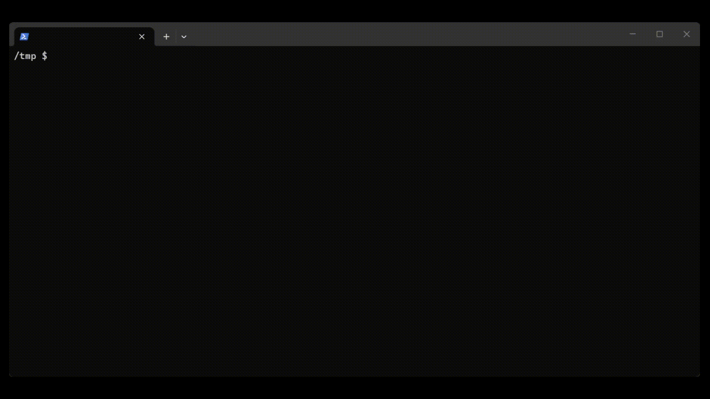

<p align="center">
  
</p>

<h2 align="center">Pragma</h2>

<p align="center">
  <em>A local agent with a memory that forgets.</em>
</p>

<p align="center">
  Your machine  ·  Open models  ·  No API key  ·  A terminal you can live in
</p>

<p align="center">
  <a href="./LICENSE"></a>
  
  
  
  
</p>

<p align="center">
  
</p>

---

Pragma runs on your machine, against a model you serve yourself. It works in
a folder of yours — reads, writes, runs commands — and **remembers between
sessions**: not by keeping a transcript, but by writing down what happened,
distilling what recurs, and letting the rest fade. Come back after a month
and it tells you what it still holds and what has gone quiet.

*From the Greek pragma — something accomplished through action.*

**Pragma is a Linux terminal program.** That is where it is developed, where
everything is tested, and what this page describes. Windows and a browser
interface exist and are [experimental](#windows-macos-and-the-browser).

---

## Install

```bash
git clone https://github.com/homoagens/pragma.git
cd pragma
./install.sh
```

You need **Python 3.10 or newer**. The installer builds Pragma its own
environment, so nothing is added to your system Python (on Debian and
Ubuntu, `sudo apt install python3-venv` first), and adds one line to your
shell profile so that `pragma` works in every new terminal.

You also need a model served on an **OpenAI-compatible endpoint** —
[llama.cpp](https://github.com/ggml-org/llama.cpp/releases), LM Studio,
Ollama, vLLM, or a hosted one. Pragma is developed on llama.cpp against two
models, depending on the graphics card, both
[Unsloth](https://huggingface.co/unsloth)'s GGUF builds at Q5 and both served
with one slot (`-np 1`):

| VRAM | Model |
|---|---|
| 12 GB | **Qwen3.6 35B-A3B · Q5**, with a 131072-token context (`-c 131072`) |
| 24 GB | **Qwen3.8 27B · Q5**, with a 65536-token context (`-c 65536`): the one in the recording above |

With one slot, a memory being written in the background and your next turn
wait for each other; `-np 2` lets them run side by side, each with half the
context.

## Run

Open a **new** terminal — the one that ran the installer has not read your
profile yet — and type:

```bash
pragma
```

Point it at your model with `/configure`, `add` (`127.0.0.1:8080` is
enough), then `/new` starts a project: a name and a folder, nothing else.

```bash
pragma --agent
```

is the agent alone: nothing is recalled and nothing is written to memory, in
any project opened from it. The stores are left as they are.

---

## Two screens

**Home** says what your model is serving and whether it answers, lists your
recent projects, names any memory still being written, and takes `/open`,
`/new`, `/projects`, `/jobs`, `/configure` and `/exit`. `/projects` is
everything done *to* a project — open one, start one, snapshot or restore its
memory, remove it.

**A project** opens on a briefing — what the memory holds, what changed while
you were away, what wants attention — and then you talk. `/memory` looks at
the store, `/settings` is what the project decides for itself, `/status` how
it is set up. `/compact` summarises a long conversation and goes on from the
summary, and `/clear` starts over with an empty context. **ctrl+D** closes
the project and hands the conversation to the memory; a second one, at home,
leaves.

**While a turn runs** you watch it happen, drawn as a ledger: one line for
each thing done — what, to what, and how it came out. The newest lines are
bright and the older ones fade; a failure stays red, with the line that says
why. What memory recalled comes first, in its own colour. Under it all, one
status line says who is working and for how long, with the model's reasoning
scrolling beneath while it lasts. The reasoning goes when it is over. The
answer stays. **ctrl+C** or **ctrl+D** stops a turn; the project stays open.

**You keep the last word.** A command that cannot be undone — deleting
files, pushing, installing, anything with `sudo` — is shown to you first and
runs only if you allow it. A refusal is final for that turn. Commands a
project runs all the time can be allowed once, in `/settings`. A file the
agent changes with its own tools is copied aside first: ask, and the session's
edits are undone.

**It can show you a picture.** A chart or an image it made is drawn in the
terminal, under the step that showed it — coarse, but there, with nothing to
install.

---

## Projects

A project is **one folder you work in** plus **a memory of its own**.

The folder is the workspace: the agent reads and writes there. The memory
lives apart, under `~/.pragma/projects/<name>` — never inside your folder,
because a workspace is often a git repository and personal episodes have no
business in one.

**`PRAGMA.md`** in the workspace is the other half. Memory is what the agent
*learns*; that file is what you *decide*, and a rule written there always
applies, on every task, without competing with anything the agent remembers.

**What the endpoint decides** — whether the model reasons, and the sampling
it travels with — is set once for the whole machine in `/configure`, and
every project talking to that server inherits it. Different servers can take
different roles: a small fast model for the recall that runs before each
turn, a larger one for the agent. **What each project decides for itself** —
how many steps a turn may take, how much the memory brings to one — lives
with the project, so two projects on one machine can disagree.

---

## The memory

Every session that was worth keeping becomes an **episode** — what you were
doing, what happened, what it seems to mean. What recurs across episodes is
distilled into **beliefs**, each carrying the episodes it rests on.

**It forgets on purpose.** An episode's salience decays with the time since
it was last recalled; below a threshold it goes dormant — out of the way, not
deleted — and comes back when a question matches it again. Nothing is
destroyed by default.

**And it changes its mind.** Later experience can rewrite what an old episode
*means* while the record of what happened stays frozen. A belief that
accumulates contradictions is reformulated rather than merely dropped.

**It finds by meaning, too.** Recall goes by the words of your request; with
an embedding server beside the model (`/configure`, `meaning`) it also finds
what was said in other words, or in another language.

**It writes while you carry on.** Turning a conversation into episodes takes
a minute of thinking, so it happens in the background: **ctrl+D** gives you
the terminal back at once and the memory finishes on its own, in its own
process. `/jobs` follows it live and names the faculty at work: the segmenter
deciding what was worth keeping, the consolidator writing the episode, the
abstractor distilling beliefs.

---

## Connecting it to other things

**MCP servers.** The agent can be offered the tools of any
[MCP](https://modelcontextprotocol.io) server: list them in `/configure`,
`mcp`, and switch off the tools you do not want. The home screen says which
servers answer.

**Other programs.** `/serve` lets a program that talks to a model — a chat
panel, a presentation tool — talk to one of your projects instead, through
the same OpenAI-compatible API, and get its memory and its tools with it. A
served project keeps running when Pragma is closed, and the home screen
always says which are on. [Serve a project](docs/how-to/serve-a-project.md),
and [use it from your own code](docs/how-to/use-pragma-from-a-program.md).

**Plugins.** A folder in `~/.pragma/plugins` can add commands to the home
screen without Pragma knowing what they do. The
[files reference](docs/reference/files.md) says how.

---

## Documentation

**<https://homoagens.github.io/pragma/>** has the rest, with a menu and a
search; the same pages are in [`docs/`](docs/README.md). Start with [your
first project](docs/tutorial/first-project.md), ten minutes from an empty
screen to a memory that came back. Then there are guides for single tasks —
connecting a model, writing rules the agent must follow, moving a project —
every [command](docs/reference/commands.md) and every
[setting](docs/reference/configuration.md) with its default, and [how Pragma
is put together](docs/explanation/architecture.md), with which file does
what.

---

## Windows, macOS and the browser

*Experimental.* They run, but new work reaches them later or not at all.
[Three interfaces, and where each stands](docs/explanation/interfaces.md)
lists what differs.

- **Windows** — `.\install.ps1`, then `pragma` in PowerShell. The same two
  screens, brought into line with Linux after each round of changes, so it
  can be a step behind. A memory written on one system can be read on the
  other.
- **macOS** — `./install.sh` and the Linux launcher. Not tested.
- **The browser** — `venv/bin/python -m agent.run`, at
  `http://localhost:8006`. The old interface, not being worked on: it has
  threads instead of projects, does not read `PRAGMA.md`, and does not write
  episodes.

---

## Research artifacts

*Coming when the paper is public.*

---

## Part of Homo Agens

Pragma is the first public project under
**[Homo Agens](https://github.com/homoagens)**, an open-source effort on
autonomous agents, local inference, and a simple thesis:

> The model matters less than the architecture around it.
> Memory, tools, transparency and execution control are what turn an LLM into
> something that gets things done.

---

## Contact

If you work on agents, local AI, or developer experience — let's talk.

<p>
  <a href="mailto:homoagens1@gmail.com"></a>
  <a href="https://x.com/homoagens1"></a>
  <a href="https://www.reddit.com/user/HomoAgens1/"></a>
</p>

---

## License

[AGPL-3.0-or-later](./LICENSE) — free to use, study, modify and share. If you
distribute a modified Pragma, or offer it to others as a service, you must
release your changes under the same license. Take freely, give back freely.
